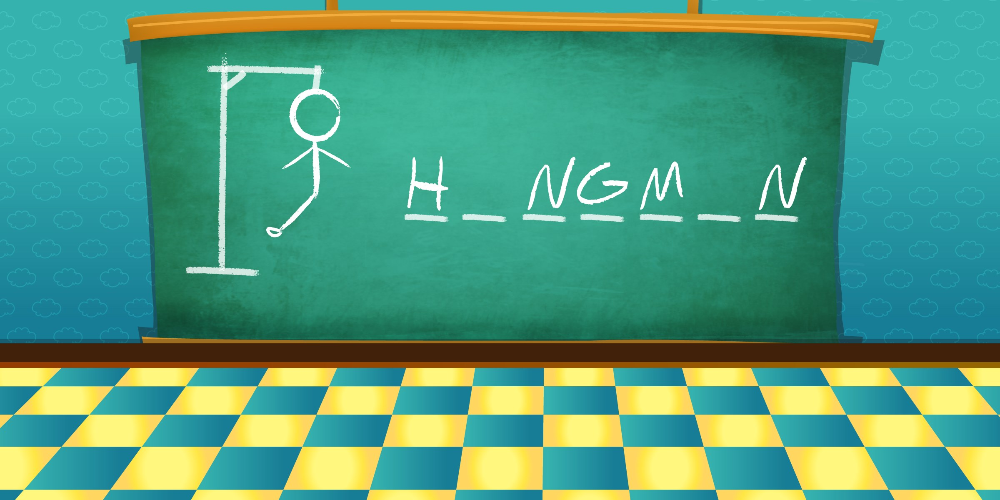

# Python Hangman Game

A classic word-guessing game built in Python where the player guesses letters of a fruit name within a limited number of attempts.

## Preview

## Concepts Used
- Loops and conditional statements
- Lists, strings, and functions
- `random` module and exception handling (`try`/`except`)

## How to Run
1. Open `hangman_game.ipynb` in Jupyter Notebook.
2. Run the cells and enter the list of fruits (or your chosen words) to start playing.
